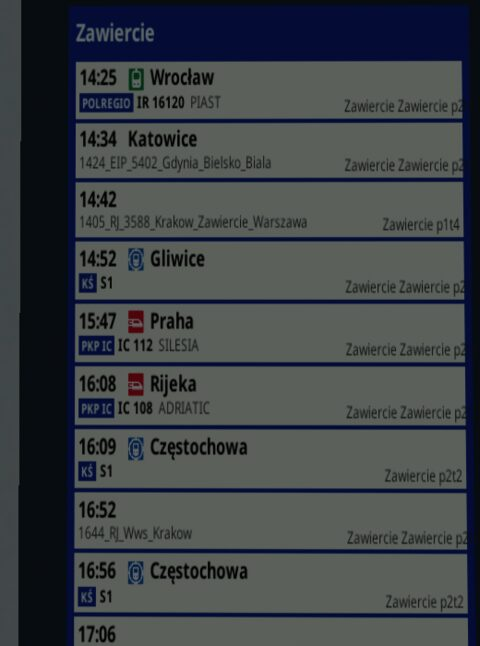
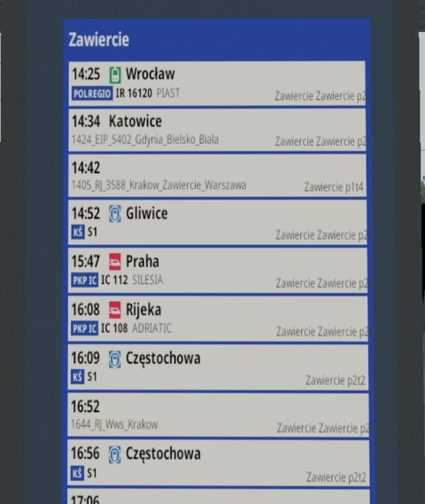
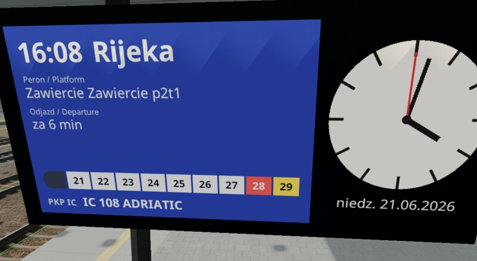
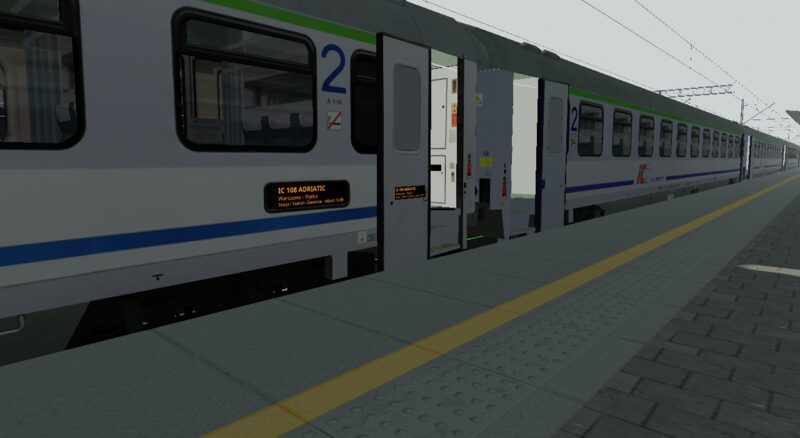
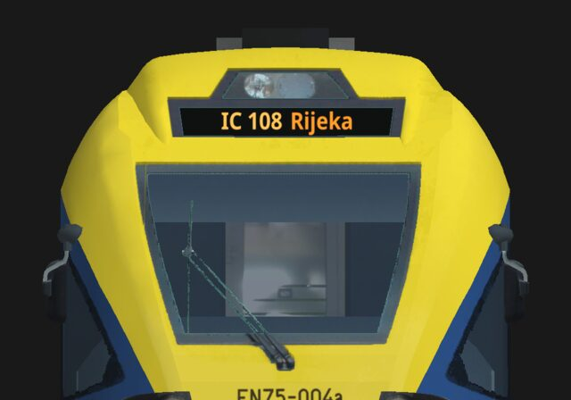

# Displays: departure boards, platform screens and train displays

*Wersja polska: [Wyświetlacze](displays.pl.md).*

A **display** shows a live document on a shape: a station's departures
board, a platform screen with the next train and a clock, a train's
destination display, the LED panel by a coach's door. TSRE draws the
document into a texture and the shape shows it, by day and by night, in the
route editor's 3D view, while the simulation runs and in the Shape Viewer.

A document is an [RmlUi](https://mikke89.github.io/RmlUiDoc/) file
(`.rml`): HTML-like markup styled with CSS-like rules. TSRE fills its data
(the clock, a station's departures and arrivals, a train's data) and draws
it again as often as the display asks.

The examples are TSRE's own (section 10); their documents are worth
opening beside this guide.

## 1. Two kinds of display

| Kind | What it is | Use it when |
| --- | --- | --- |
| **Texture replacement** | One of the shape's texture images (by its file name) is replaced, the whole of it, by the document. Every part of the shape that uses that image shows the document. | The display area has a texture of its own: a board's face, a train's destination display texture. |
| **Square** | A flat rectangle TSRE adds to the shape, hung on one of its matrices, with a place, a turn and a size. It moves with that matrix (doors, pantographs). | The display area is painted inside a shared texture (an atlas), or a display goes where the shape has none. |

A texture replacement draws the document over the **whole texture**: lay
the document out as the shape maps the texture. Areas of a texture (UV
rectangles) are not supported.





## 2. Add a display to a station shape

The departures board `ORB_Tpo4` has its own texture for its face,
`ORB_Tpo_ODJAZDY.ACE`.

1. Put the document in the route's `DISPLAYS` folder:
   `ROUTES/<route>/DISPLAYS/odjazdy.rml`.
2. Add a block to the shape's `.sd` file (`ROUTES/<route>/SHAPES/ORB_Tpo4.sd`),
   inside its `shape ( … )` block:

   ```
   ESD_TSREDisplay (
       Document ( "odjazdy.rml" )
       Image ( "ORB_Tpo_ODJAZDY.ACE" )
       Resolution ( 512 1024 )
       Surface ( Paper )
       RefreshRate ( 0.2 )
       Input ( Station )
   )
   ```
3. Open the route. Where the board stands, TSRE finds the nearest platform
   and its station, and the board lists the station's trains. Run the
   simulation (or an Open Rails timetable) to fill it.

A screen on a hanging clock whose LCD is painted in a shared texture takes
a square instead:

```
ESD_TSREDisplay (
    Document ( "peron_lcd.rml" )
    ShapeHierarchy ( "MAIN" )
    Position ( -0.207 0.414 0.001 )
    Rotation ( 8.4 -90 0 )
    Size ( 1.389 0.670 0 )
    Resolution ( 1040 500 )
    Surface ( Glass )
    RefreshRate ( 1 )
    Input ( Platform )
)
```



## 3. Add a display to a train

A car's displays are defined the same way, in its shape's `.sd`, with the
documents in the trainset's `DISPLAYS` folder
(`TRAINS/TRAINSET/<folder>/DISPLAYS`). With `Input ( Train )` the document
gets the train the car runs in: the simulation gives each car its train.

The Z2B coach (`PKP_Z2B-OR/PKPIC_B11mnouz-70082.sd`) has four squares: two
on the body over the painted LED panels, and two on door leaves, which
slide with the doors:

```
ESD_TSREDisplay (
    Document ( "z2_drzwi.rml" )
    ShapeHierarchy ( "DOOR_B" )
    Position ( 0.076 -0.625 0 )
    Rotation ( 0 90 0 )
    Size ( 0.5 0.135 0 )
    Resolution ( 624 168 )
    Surface ( Glass )
    RefreshRate ( 1 )
    Input ( Train )
)
```

`Position` is in the matrix's own space: here 7.6 cm out from the door
leaf's origin and 62.5 cm below it.



The EN75 (`KS_EN75`) has a texture holding only its destination displays,
`EN75_wyswietlacz.ace`: a texture replacement, with the document drawing
the front and side bands where the shape maps them.



## 4. The `.sd` block

One `ESD_TSREDisplay ( … )` block per display, inside the `.sd`'s
`shape ( … )` block, each value a named entry. Names are not case
sensitive. The `.sd` must be a text (Unicode) file.

| Entry | Values | Meaning |
| --- | --- | --- |
| `Document` | `"file.rml"` | The document, in the route's or the trainset's `DISPLAYS` folder; a subfolder is allowed (`"boards/odjazdy.rml"`). Required. |
| `Image` | `"name.ace"` | A texture replacement: the texture image, as the shape's `images` list names it (no folder). |
| `ShapeHierarchy` | `"MATRIX"` | A square: the matrix it hangs on. Optional: the shape's root. |
| `Position` | `x y z` | A square: its centre, metres, in that matrix's space. |
| `Rotation` | `x y z` | A square: degrees about x, then y, then z. Before it, a square lies in the x–y plane facing +z. Optional. |
| `Size` | `w h 0` | A square: width and height in metres (the third value is always 0). |
| `Resolution` | `w h` | The document's size in pixels. Optional for `Image` (the texture's size); a square's default is 512 × 256. Keep the square's proportions. |
| `Surface` | `Glass` or `Paper` | `Glass` shines as drawn at any hour (a screen, an LED panel); `Paper` is lit by the scene, dark at night unless a lamp reaches it. Optional: a replaced texture keeps its parts' own material; a square is `Glass`. |
| `RefreshRate` | `n` | Redraws per second; a fraction for a slower one: `0.2` is a redraw every 5 seconds. `0` draws it once. |
| `Input` | `Platform`, `Station`, `Train` | What the document gets besides the clock (section 6). Optional: the clock only. `Clock` is read as the same. |

A block needs a `Document`, and either an `Image` or a `Position` and a
`Size`; otherwise it is left out (and reported, section 9).

## 5. Writing documents

- **The data model:** the document's body binds the data model `display`:
  `<body data-model="display">`. Texts are `{{station}}`, lists
  `data-for="row, i : departures"`, conditions `data-if="…"`, and any
  attribute or style can be bound (`data-attr-src`, `data-style-…`). See
  RmlUi's data bindings documentation.
- **Fonts:** TSRE's UI fonts, `Noto Sans` regular and bold.
- **Pictures:** an `` or a `decorator: image(…)` is read from
  the asset's **texture folder**, as its shapes' textures are: the route's
  `TEXTURES` for a route's document, the trainset's own folder for a
  train's. Formats: ACE, DDS, PNG, JPG, BMP, TGA. Pictures load in the
  background; a display drawn before its pictures arrive is drawn again
  as soon as they are there.
- **Stylesheets and scripts** (`.rcss`, `.lua`) are read next to the
  document.
- **Sharing:** displays showing the same document, with the same inputs
  (the same platform, station or train) at the same resolution, share one
  texture: a station's boards, a train's cars.
- **Redraws:** a display is drawn again when its `RefreshRate` says, while
  it is in view. At most `Display redraws per frame` documents
  (`core.rendering.displayRedraws`, Settings, default 2) are drawn in one
  frame, one of them loading: the longest waiting first, nearer ones
  before farther ones.

### TSRE's functions

TSRE adds functions to documents' expressions, for what data binding
alone cannot do: formatting a time or a date, a countdown, switching
languages. Write `{{ value | function(arguments) }}`, or
`function(arguments)`; pipes chain. An empty value (data a train has not)
gives empty text, except with `default`.

| Function | Does | Example |
| --- | --- | --- |
| `format_time(pattern)` | A time (`HH:mm`) in a Qt time pattern. | `{{ row.time \| format_time('h:mm AP') }}` → `2:25 PM` |
| `format_date(pattern, language)` | `date` in a Qt date pattern; names of days and months in the language, English without one. | `{{ date \| format_date('dd.MM.yyyy') }}` → `02.11.2026`; `format_date('dddd', 'pl')` → `poniedziałek` |
| `pad(width, fill)` | Filled on the left (with `0` unless `fill` says). | `{{ day \| pad(2) }}` → `02` |
| `default(text)` | `text` where the value is empty. | `{{ row.platform \| default('-') }}` |
| `add_minutes(n)` | The time `n` minutes later. | `{{ row.time \| add_minutes(row.delay) }}`: the expected time |
| `minutes_until(clock)` | Minutes from the clock to a time, negative once passed. | `{{ row.time \| add_minutes(row.delay) \| minutes_until(clock) }} min` |
| `cycle(seconds, a, b, …)` | One of the values in turn by the clock, each for that many seconds. | `{{ clock \| cycle(4, 'Odjazdy', 'Departures') }}`; `data-if="clock \| cycle(4, true, false)"` |

The clock goes into `cycle` and `minutes_until` as `clock`: RmlUi works an
expression out again only when data in it changes. RmlUi's own functions
are there too: `to_upper`, `to_lower`, `format(decimals)`, `round`. A
display changing every few seconds (`cycle`, a countdown) needs a
`RefreshRate` to match.

### Lua

Data binding and TSRE's functions are enough for most documents. A
document may also run Lua
(RmlUi's Lua plugin): `<script src="file.lua"></script>` in its head, and
handlers in its elements. On each redraw TSRE sends the document a
`displayupdate` event, `event.parameters.time` being the clock's seconds
after midnight:

```
<body data-model="display" ondisplayupdate="z2DrzwiUpdate(event, document)">
```

```
function z2DrzwiUpdate(event, document)
    local english = math.floor(event.parameters.time / 4) % 2 == 1
    document:GetElementById("pl"):SetClass("hidden", english)
    document:GetElementById("en"):SetClass("hidden", not english)
end
```

All documents share one Lua state: give global functions names that cannot
clash with another document's. Lua runs under a time limit. (This example,
z2_drzwi_lua.rml, is also there without Lua: z2_drzwi.rml does the same with
`cycle`.)

## 6. What a document can read

Every document:

| Name | Value |
| --- | --- |
| `time` | The clock, `HH:mm` (the simulation's while it runs, else the route's). |
| `clock` | The clock in seconds after midnight, for `cycle` and `minutes_until`. |
| `date` | `yyyy-MM-dd`. |
| `hours`, `minutes`, `seconds` | Numbers, for clock hands (`data-style-transform`). |
| `year`, `month`, `day` | Numbers, for a date in another order (or `format_date`). |

With `Input ( Platform )` (the nearest platform line within 300 m; a
square's readers stand 3 m in front of it) or `Input ( Station )` (all the
station's platforms):

| Name | Value |
| --- | --- |
| `station`, `platform` | The station's name; the platform's (not for `Station`). |
| `departures`, `arrivals` | Lists of rows, by time; a stop already passed is left out. |
| `row.time` | The booked time. |
| `row.id` | The train's timetable name. |
| `row.category`, `row.number`, `row.name`, `row.operator`, `row.line` | The train's fields (section 7), empty where it has none. |
| `row.origin`, `row.destination` | Its own (section 7), else the stations of its first and last stops on the route (empty where it comes onto the route or leaves it here). |
| `row.platform` | The platform it stops at. |
| `row.delay` | Minutes late, empty on time. |
| `row.extra.<key>` | The user's own data (section 7), empty text for a key the train has not. |

With `Input ( Train )` (a car's display):

| Name | Value |
| --- | --- |
| `train.id` | Its timetable name. |
| `train.category`, `train.number`, `train.name`, `train.operator`, `train.line` | Its fields (section 7). |
| `train.origin`, `train.destination` | Its own, else the stations of its first and last stops. |
| `train.state` | `waiting` (not started), `standing` (at a station), `held` (stopped elsewhere), `running`, `approaching` (within 500 m of its next stop), `finished`; empty without the simulation. |
| `train.at` | The station it stands at. |
| `train.next` | The next stop it reaches (while standing, the one after). |
| `train.previous` | The station it left last. |
| `train.platform` | The platform it stands at, else its next stop's. |
| `train.departs`, `train.arrives` | Booked departure from where it stands (or its first stop while waiting); booked arrival at `next`. |
| `train.distance` | Metres to its next stop, where known. |
| `train.delay` | Minutes late. |
| `train.stops` | Its stops on the route, a list: `station`, `platform`, `arrives`, `departs` (booked), `passed` (left already). |
| `train.extra.<key>` | The user's own data (section 7). |

A train without its fields: show them where it has them, its timetable
name where not:

```
<span data-if="row.category != ''">{{row.category}} {{row.number}} {{row.name}}</span>
<span data-if="row.category == ''">{{row.id}}</span>
```

The stops still ahead of a train:

```
<span data-for="stop : train.stops">
    <span data-if="!stop.passed">{{stop.station}}</span>
</span>
```

## 7. Train data in a timetable

An Open Rails timetable names each train once, by its column's head; there
is no field for its number, category or operator, so authors often pack
them into the name (`0846_IR46140SZYNDZIELNIA_KK-O`). To show them
separately, write them in rows of their own.

**TSRE's train fields**, each optional: write the ones your route needs.

| Row | Field |
| --- | --- |
| `#tsre.category` | The category: `IC`, `TLK`, `R`. |
| `#tsre.number` | The train's number. |
| `#tsre.name` | Its proper name: `PIAST`. |
| `#tsre.operator` | The operator: `PKP IC`, `POLREGIO`. |
| `#tsre.line` | The line: `S1`. |
| `#tsre.origin` | Where it comes from, beyond the route. |
| `#tsre.destination` | Where it goes, beyond the route. |

```
#tsre.category;;IR;TLK;…
#tsre.number;;61120;62102;…
#tsre.name;;PIAST;SZTYGAR;…
```

**The user's own data:** rows `#tsre.extra.<key>`, any key; documents read
them as `row.extra.<key>` and `train.extra.<key>`:

```
#tsre.extra.kind;;regional;regional;…
```

- A train's cell is its value; an empty cell, none.
- Keys are lower case (Open Rails lower-cases a row's first cell), of
  letters, digits and `_` only.
- Open Rails reads such a timetable: each of these rows is one "Invalid row
  definition" line in its log, and the row is ignored. Use rows, never
  columns.
- TSRE's timetable window writes the rows back when it saves.

The examples use the seven fields, and `kind` (`fast`, `regional`, `aglo`)
for the boards' train-type pictograms (`rodzaj_pociagu_<kind>.png` in the
route's `TEXTURES`).

## 8. Glass, paper and the night

- `Glass`: the document's colours as drawn, at any hour, as a lit screen.
  A square is glass unless it says otherwise.
- `Paper`: lit as the scene lights it: bright by day, dark at night unless
  a lamp reaches it. A printed board.
- Without `Surface`, a replaced texture's parts keep the shape's own
  material, PBR included.

The departures board in section 1 is shown both ways, by day under the
platform's roof.

## 9. Messages and troubleshooting

Problems are listed in **Window > Errors and Messages**, each once:

- a block left out (no `Document`; neither an `Image` nor a `Position` and
  a `Size`);
- a document not found, or outside the `DISPLAYS` folder;
- an `Image` the shape has not (nothing shows the document);
- a `ShapeHierarchy` the shape has not (the square hangs on the root);
- a picture not found;
- a document that did not load, and RmlUi's errors and warnings in a
  document (its log has the details).

In the Shape Viewer, a shape's displays show sample data: a station with
departures and arrivals, and a train (IC 108 ADRIATIC).

## 10. Examples

TSRE's documentation has example documents in
[docs/examples/displays](../examples/displays/README.md), laid out as in a
game folder, with the pictures they use and a README giving each
document's `.sd` blocks. Each document begins with a note on what it shows
and how.

| Example | Kind | Shows | Uses |
| --- | --- | --- | --- |
| `ROUTES/PRUDNIK/DISPLAYS/odjazdy.rml`, `przyjazdy.rml` | Texture, paper; Station | A station's departures and arrivals boards. | Lists; the train's fields, its timetable name where it has none; a pictogram picked by `row.extra.kind`; the delay. |
| `ROUTES/PRUDNIK/DISPLAYS/peron_lcd.rml` | Squares, glass; Platform | A platform screen with an analog clock. | `add_minutes` and `minutes_until` (the minutes until the train leaves), `format_date`; clock hands bound to `hours`, `minutes`, `seconds`. |
| `TRAINS/TRAINSET/KS_EN75/DISPLAYS/en75_wyswietlacze.rml` | Texture, glass; Train | An EMU's front and side destination displays. | The train's state; `train.stops` (the stops still ahead). |
| `TRAINS/TRAINSET/PKP_Z2B-OR/DISPLAYS/z2_drzwi.rml` | Squares, glass; Train | A coach's panels on the body and on door leaves, moving with the doors. | `cycle`: Polish, then English. |
| `TRAINS/TRAINSET/PKP_Z2B-OR/DISPLAYS/z2_drzwi_lua.rml`, `z2_drzwi.lua` | Squares, glass; Train | The same panels. | Lua on `displayupdate`. |

They were made for shapes of OR_PSK's Prudnik route, hence
`ROUTES/PRUDNIK`; the README names the shapes. For another shape, lay the document out
for its texture or its square, and keep the rest.

## 11. Known limits

- Displays on static objects and on cars; not yet on signals, level
  crossings or other objects with shapes.
- MSTS shapes only for now (glTF shapes later); a text `.sd` only.
- A display's refresh counts real time: while paused, a clock display is
  still drawn again (the same picture).
- Not yet: displays in cabs (the cab's screens, CVF) and clicking on a
  display; both come later.
