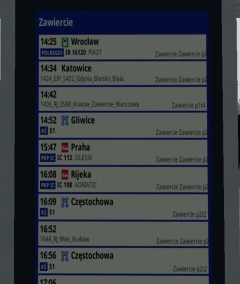
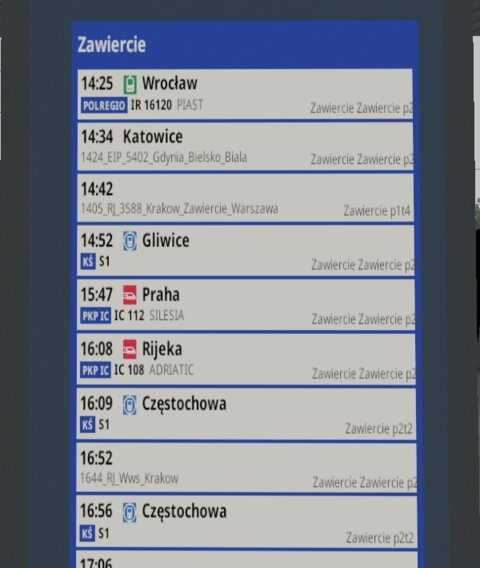
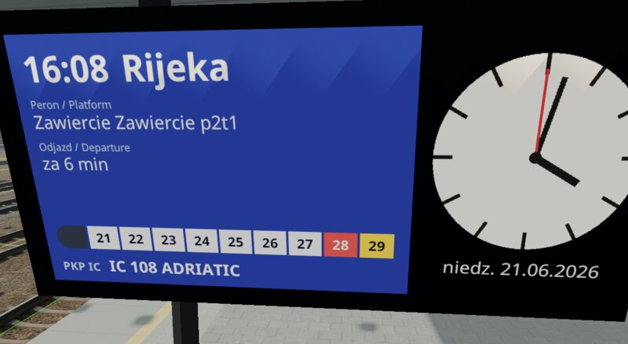
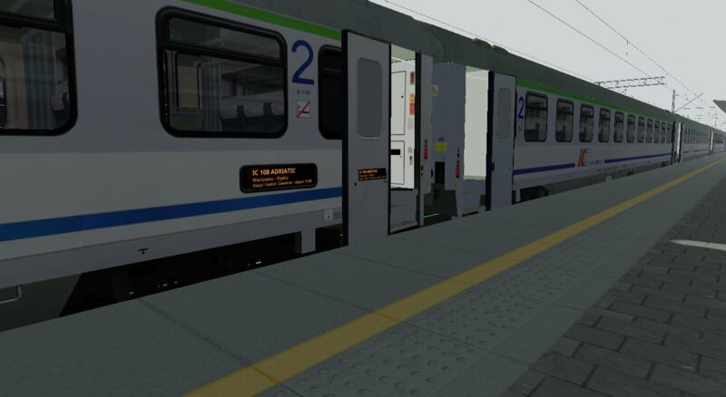
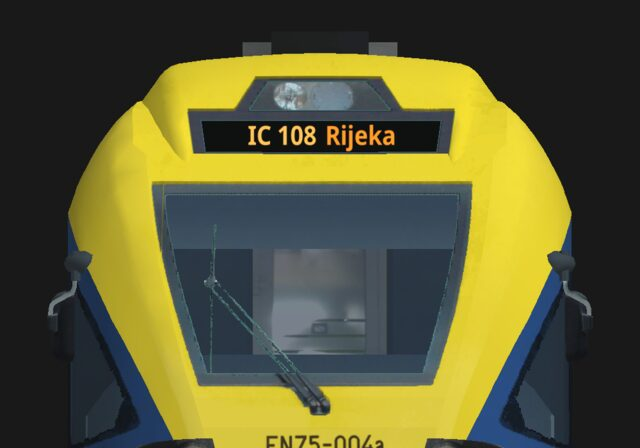

# Wyświetlacze: tablice odjazdów, ekrany peronowe i wyświetlacze w pociągach

*English version: [Displays](displays.md).*

**Wyświetlacz** pokazuje na kształcie żywy dokument: tablicę odjazdów na
stacji, ekran peronowy z najbliższym pociągiem i zegarem, wyświetlacz
kierunkowy pociągu, panel LED przy drzwiach wagonu. TSRE rysuje dokument do
tekstury, a kształt ją pokazuje, w dzień i w nocy: w widoku 3D edytora tras,
podczas symulacji i w przeglądarce modeli 3D (Shape Viewer).

Dokument to plik [RmlUi](https://mikke89.github.io/RmlUiDoc/) (`.rml`):
znaczniki podobne do HTML ze stylami podobnymi do CSS. TSRE wypełnia go
danymi (zegar, odjazdy i przyjazdy stacji, dane pociągu) i rysuje go ponownie
tak często, jak chce tego wyświetlacz.

Przykłady są częścią TSRE (rozdział 10); warto otworzyć ich dokumenty
obok tego poradnika.

## 1. Dwa rodzaje wyświetlaczy

| Rodzaj | Co to jest | Kiedy go użyć |
| --- | --- | --- |
| **Podmiana tekstury** | Jeden z obrazów tekstur kształtu (wskazany nazwą pliku) zostaje w całości zastąpiony dokumentem. Każda część kształtu, która używa tego obrazu, pokazuje dokument. | Wyświetlacz ma własną teksturę: lico tablicy, tekstura wyświetlacza kierunkowego pociągu. |
| **Prostokąt** | Płaski prostokąt, który TSRE dodaje do kształtu, zawieszony na jednej z jego macierzy, z położeniem, obrotem i rozmiarem. Porusza się razem z tą macierzą (drzwi, pantografy). | Wyświetlacz jest namalowany na wspólnej teksturze (atlasie) albo ma się znaleźć tam, gdzie kształt go nie ma. |

Podmiana tekstury rysuje dokument na **całej teksturze**: rozmieść treść
dokumentu tak, jak kształt mapuje teksturę. Fragmenty tekstury (prostokąty
UV) nie są obsługiwane.





## 2. Wyświetlacz na kształcie stacyjnym

Tablica odjazdów `ORB_Tpo4` ma na swoje lico osobną teksturę,
`ORB_Tpo_ODJAZDY.ACE`.

1. Umieść dokument w folderze `DISPLAYS` trasy:
   `ROUTES/<route>/DISPLAYS/odjazdy.rml`.
2. Dodaj blok do pliku `.sd` kształtu (`ROUTES/<route>/SHAPES/ORB_Tpo4.sd`),
   wewnątrz jego bloku `shape ( … )`:

   ```
   ESD_TSREDisplay (
       Document ( "odjazdy.rml" )
       Image ( "ORB_Tpo_ODJAZDY.ACE" )
       Resolution ( 512 1024 )
       Surface ( Paper )
       RefreshRate ( 0.2 )
       Input ( Station )
   )
   ```
3. Otwórz trasę. Tam, gdzie stoi tablica, TSRE znajduje najbliższy peron i
   jego stację, a tablica pokazuje pociągi tej stacji. Uruchom symulację
   (albo rozkład jazdy Open Rails), żeby ją wypełnić.

Ekran na wiszącym zegarze, którego wyświetlacz LCD jest namalowany na
wspólnej teksturze, dostaje zamiast tego prostokąt:

```
ESD_TSREDisplay (
    Document ( "peron_lcd.rml" )
    ShapeHierarchy ( "MAIN" )
    Position ( -0.207 0.414 0.001 )
    Rotation ( 8.4 -90 0 )
    Size ( 1.389 0.670 0 )
    Resolution ( 1040 500 )
    Surface ( Glass )
    RefreshRate ( 1 )
    Input ( Platform )
)
```



## 3. Wyświetlacz w pociągu

Wyświetlacze wagonu definiuje się tak samo, w pliku `.sd` jego kształtu, a
dokumenty leżą w folderze `DISPLAYS` zestawu taboru
(`TRAINS/TRAINSET/<folder>/DISPLAYS`). Z `Input ( Train )` dokument dostaje
pociąg, w którym jedzie wagon: symulacja przekazuje każdemu wagonowi jego
pociąg.

Wagon Z2B (`PKP_Z2B-OR/PKPIC_B11mnouz-70082.sd`) ma cztery prostokąty: dwa
na pudle, na namalowanych panelach LED, i dwa na skrzydłach drzwi, które
przesuwają się razem z drzwiami:

```
ESD_TSREDisplay (
    Document ( "z2_drzwi.rml" )
    ShapeHierarchy ( "DOOR_B" )
    Position ( 0.076 -0.625 0 )
    Rotation ( 0 90 0 )
    Size ( 0.5 0.135 0 )
    Resolution ( 624 168 )
    Surface ( Glass )
    RefreshRate ( 1 )
    Input ( Train )
)
```

`Position` podaje się w układzie współrzędnych macierzy: tutaj 7,6 cm na
zewnątrz od początku układu skrzydła drzwi i 62,5 cm poniżej niego.



EN75 (`KS_EN75`) ma teksturę, na której są tylko jego wyświetlacze
kierunkowe, `EN75_wyswietlacz.ace`: to podmiana tekstury, a dokument rysuje
pasy czołowe i boczne tam, gdzie mapuje je kształt.



## 4. Blok w pliku `.sd`

Jeden blok `ESD_TSREDisplay ( … )` na wyświetlacz, wewnątrz bloku
`shape ( … )` pliku `.sd`; każda wartość to nazwany wpis. Wielkość liter w
nazwach nie ma znaczenia. Plik `.sd` musi być plikiem tekstowym (Unicode).

| Wpis | Wartości | Znaczenie |
| --- | --- | --- |
| `Document` | `"plik.rml"` | Dokument, w folderze `DISPLAYS` trasy albo zestawu taboru; może leżeć w podfolderze (`"tablice/odjazdy.rml"`). Wymagany. |
| `Image` | `"nazwa.ace"` | Podmiana tekstury: obraz tekstury, tak jak nazywa go lista `images` kształtu (bez folderu). |
| `ShapeHierarchy` | `"MACIERZ"` | Prostokąt: macierz, na której wisi. Opcjonalny: domyślnie korzeń kształtu. |
| `Position` | `x y z` | Prostokąt: jego środek, w metrach, w układzie tej macierzy. |
| `Rotation` | `x y z` | Prostokąt: stopnie wokół x, potem y, potem z. Bez obrotu prostokąt leży w płaszczyźnie x–y, zwrócony w stronę +z. Opcjonalny. |
| `Size` | `szer wys 0` | Prostokąt: szerokość i wysokość w metrach (trzecia wartość to zawsze 0). |
| `Resolution` | `szer wys` | Rozmiar dokumentu w pikselach. Opcjonalny dla `Image` (rozmiar tekstury); dla prostokąta domyślnie 512 × 256. Zachowaj proporcje prostokąta. |
| `Surface` | `Glass` albo `Paper` | `Glass` świeci tak, jak go narysowano, o każdej porze (ekran, panel LED); `Paper` oświetla scena, w nocy jest ciemny, chyba że dosięga go lampa. Opcjonalny: podmieniona tekstura zachowuje materiał swoich części, prostokąt jest `Glass`. |
| `RefreshRate` | `n` | Odświeżenia na sekundę; ułamek dla rzadszych: `0.2` to odświeżenie co 5 sekund. `0` rysuje dokument raz. |
| `Input` | `Platform`, `Station`, `Train` | Co dokument dostaje oprócz zegara (rozdział 6). Opcjonalny: wtedy tylko zegar. `Clock` znaczy to samo. |

Blok potrzebuje wpisu `Document` oraz albo `Image`, albo `Position` i
`Size`; w przeciwnym razie jest pomijany (i zgłaszany, rozdział 9).

## 5. Pisanie dokumentów

- **Model danych:** `body` dokumentu wiąże model danych `display`:
  `<body data-model="display">`. Teksty to `{{station}}`, listy
  `data-for="row, i : departures"`, warunki `data-if="…"`, a powiązać można
  każdy atrybut i styl (`data-attr-src`, `data-style-…`). Szczegóły w
  dokumentacji wiązania danych (data bindings) RmlUi.
- **Czcionki:** czcionki interfejsu TSRE, `Noto Sans` zwykła i pogrubiona.
- **Obrazy:** `` i `decorator: image(…)` są czytane z
  **folderu tekstur** zasobu, tak jak tekstury jego kształtów: z `TEXTURES`
  trasy dla dokumentu trasy, z własnego folderu zestawu taboru dla dokumentu
  pociągu. Formaty: ACE, DDS, PNG, JPG, BMP, TGA. Obrazy wczytują się w tle;
  wyświetlacz narysowany, zanim dotrą, jest rysowany ponownie, gdy tylko
  będą gotowe.
- **Arkusze stylów i skrypty** (`.rcss`, `.lua`) są czytane z folderu
  dokumentu.
- **Współdzielenie:** wyświetlacze, które pokazują ten sam dokument z tymi
  samymi danymi wejściowymi (ten sam peron, stacja albo pociąg) w tej samej
  rozdzielczości, dzielą jedną teksturę: tablice jednej stacji, wagony
  jednego pociągu.
- **Odświeżanie:** wyświetlacz jest rysowany ponownie tak, jak podaje
  `RefreshRate`, gdy jest w polu widzenia. W jednej klatce rysuje się
  najwyżej tyle dokumentów, ile podaje ustawienie
  `Odświeżenia wyświetlaczy na klatkę` (`core.rendering.displayRedraws`,
  Ustawienia, domyślnie 2), w tym najwyżej jeden wczytywany: najpierw te,
  które czekają najdłużej, bliższe przed dalszymi.

### Funkcje TSRE

TSRE dodaje do wyrażeń dokumentów funkcje do tego, czego samo wiązanie
danych nie potrafi: formatowania czasu i daty, odliczania, przełączania
języków. Pisz `{{ wartość | funkcja(argumenty) }}` albo
`funkcja(argumenty)`; potoki można łączyć. Pusta wartość (dane, których
pociąg nie ma) daje pusty tekst, z wyjątkiem `default`.

| Funkcja | Działanie | Przykład |
| --- | --- | --- |
| `format_time(wzorzec)` | Czas (`HH:mm`) według wzorca czasu Qt. | `{{ row.time \| format_time('h:mm AP') }}` → `2:25 PM` |
| `format_date(wzorzec, język)` | `date` według wzorca daty Qt; nazwy dni i miesięcy w danym języku, bez niego po angielsku. | `{{ date \| format_date('dd.MM.yyyy') }}` → `02.11.2026`; `format_date('dddd', 'pl')` → `poniedziałek` |
| `pad(szerokość, znak)` | Uzupełnia z lewej (zerami, chyba że podano `znak`). | `{{ day \| pad(2) }}` → `02` |
| `default(tekst)` | `tekst`, gdy wartość jest pusta. | `{{ row.platform \| default('-') }}` |
| `add_minutes(n)` | Czas o `n` minut późniejszy. | `{{ row.time \| add_minutes(row.delay) }}`: czas rzeczywisty |
| `minutes_until(clock)` | Minuty od zegara do danego czasu, ujemne, gdy minął. | `{{ row.time \| add_minutes(row.delay) \| minutes_until(clock) }} min` |
| `cycle(sekundy, a, b, …)` | Po kolei jedna z wartości według zegara, każda przez tyle sekund. | `{{ clock \| cycle(4, 'Odjazdy', 'Departures') }}`; `data-if="clock \| cycle(4, true, false)"` |

Zegar trafia do `cycle` i `minutes_until` jako `clock`: RmlUi oblicza
wyrażenie ponownie tylko wtedy, gdy zmienią się dane w nim użyte. Są też
funkcje samego RmlUi: `to_upper`, `to_lower`, `format(miejsca)`, `round`.
Wyświetlacz, który zmienia się co kilka sekund (`cycle`, odliczanie),
potrzebuje odpowiedniego `RefreshRate`.

### Lua

Do większości dokumentów wystarczy wiązanie danych i funkcje TSRE. Dokument może też
uruchamiać Lua (wtyczka Lua do RmlUi): `<script src="plik.lua"></script>` w
nagłówku i procedury obsługi zdarzeń w elementach. Przy każdym odświeżeniu
TSRE wysyła do dokumentu zdarzenie `displayupdate`, a
`event.parameters.time` to liczba sekund zegara od północy:

```
<body data-model="display" ondisplayupdate="z2DrzwiUpdate(event, document)">
```

```
function z2DrzwiUpdate(event, document)
    local english = math.floor(event.parameters.time / 4) % 2 == 1
    document:GetElementById("pl"):SetClass("hidden", english)
    document:GetElementById("en"):SetClass("hidden", not english)
end
```

Wszystkie dokumenty dzielą jeden stan Lua: nadawaj funkcjom globalnym takie
nazwy, które nie zderzą się z funkcjami innego dokumentu. Lua działa z
limitem czasu. (Ten przykład, z2_drzwi_lua.rml, jest też w wersji bez Lua:
z2_drzwi.rml robi to samo funkcją `cycle`.)

## 6. Co dokument może odczytać

Każdy dokument:

| Nazwa | Wartość |
| --- | --- |
| `time` | Zegar, `HH:mm` (symulacji, gdy działa, w przeciwnym razie trasy). |
| `clock` | Zegar w sekundach od północy, dla `cycle` i `minutes_until`. |
| `date` | `yyyy-MM-dd`. |
| `hours`, `minutes`, `seconds` | Liczby, do wskazówek zegara (`data-style-transform`). |
| `year`, `month`, `day` | Liczby, do daty w innym porządku (albo `format_date`). |

Z `Input ( Platform )` (najbliższa krawędź peronu w promieniu 300 m; dla
prostokąta liczona od miejsca 3 m przed nim, gdzie stoi patrzący) albo
`Input ( Station )` (wszystkie perony stacji):

| Nazwa | Wartość |
| --- | --- |
| `station`, `platform` | Nazwa stacji; nazwa peronu (nie dla `Station`). |
| `departures`, `arrivals` | Listy wierszy, według czasu; postój, który już minął, jest pomijany. |
| `row.time` | Czas według rozkładu. |
| `row.id` | Nazwa pociągu w rozkładzie. |
| `row.category`, `row.number`, `row.name`, `row.operator`, `row.line` | Pola pociągu (rozdział 7), puste, gdy ich nie ma. |
| `row.origin`, `row.destination` | Jego własne (rozdział 7), w przeciwnym razie stacje jego pierwszego i ostatniego postoju na trasie (puste, gdy pociąg w tym miejscu wjeżdża na trasę albo z niej zjeżdża). |
| `row.platform` | Peron, przy którym się zatrzymuje. |
| `row.delay` | Minuty opóźnienia; puste, gdy pociąg jedzie punktualnie. |
| `row.extra.<klucz>` | Własne dane użytkownika (rozdział 7); pusty tekst dla klucza, którego pociąg nie ma. |

Z `Input ( Train )` (wyświetlacz wagonu):

| Nazwa | Wartość |
| --- | --- |
| `train.id` | Jego nazwa w rozkładzie. |
| `train.category`, `train.number`, `train.name`, `train.operator`, `train.line` | Jego pola (rozdział 7). |
| `train.origin`, `train.destination` | Jego własne, w przeciwnym razie stacje jego pierwszego i ostatniego postoju. |
| `train.state` | `waiting` (jeszcze nie wyruszył), `standing` (stoi na stacji), `held` (zatrzymany gdzie indziej), `running` (w drodze), `approaching` (do najbliższego postoju zostało najwyżej 500 m), `finished` (zakończył bieg); puste bez symulacji. |
| `train.at` | Stacja, na której stoi. |
| `train.next` | Następny postój, do którego dojedzie (gdy stoi: kolejny po tym). |
| `train.previous` | Ostatnia stacja, z której odjechał. |
| `train.platform` | Peron, przy którym stoi, w przeciwnym razie peron następnego postoju. |
| `train.departs`, `train.arrives` | Odjazd według rozkładu z miejsca, w którym stoi (przed wyruszeniem: z pierwszego postoju); przyjazd według rozkładu do `next`. |
| `train.distance` | Metry do następnego postoju, jeśli są znane. |
| `train.delay` | Minuty opóźnienia. |
| `train.stops` | Jego postoje na trasie, lista: `station`, `platform`, `arrives`, `departs` (według rozkładu), `passed` (już odjechał). |
| `train.extra.<klucz>` | Własne dane użytkownika (rozdział 7). |

Pociąg bez pól: pokaż je, gdy są, a gdy ich nie ma, nazwę z rozkładu:

```
<span data-if="row.category != ''">{{row.category}} {{row.number}} {{row.name}}</span>
<span data-if="row.category == ''">{{row.id}}</span>
```

Postoje, które pociąg ma jeszcze przed sobą:

```
<span data-for="stop : train.stops">
    <span data-if="!stop.passed">{{stop.station}}</span>
</span>
```

## 7. Dane pociągów w rozkładzie jazdy

Rozkład jazdy Open Rails nazywa każdy pociąg raz, nagłówkiem jego kolumny;
nie ma pola na numer, kategorię ani przewoźnika, więc autorzy często
upychają je w nazwie (`0846_IR46140SZYNDZIELNIA_KK-O`). Żeby pokazać je
osobno, zapisz je w osobnych wierszach.

**Pola pociągu TSRE**, każde opcjonalne: wpisz te, których potrzebuje
twoja trasa.

| Wiersz | Pole |
| --- | --- |
| `#tsre.category` | Kategoria: `IC`, `TLK`, `R`. |
| `#tsre.number` | Numer pociągu. |
| `#tsre.name` | Jego nazwa własna: `PIAST`. |
| `#tsre.operator` | Przewoźnik: `PKP IC`, `POLREGIO`. |
| `#tsre.line` | Linia: `S1`. |
| `#tsre.origin` | Skąd przyjeżdża, spoza trasy. |
| `#tsre.destination` | Dokąd jedzie, poza trasę. |

```
#tsre.category;;IR;TLK;…
#tsre.number;;61120;62102;…
#tsre.name;;PIAST;SZTYGAR;…
```

**Własne dane użytkownika:** wiersze `#tsre.extra.<klucz>`, z dowolnym
kluczem; dokumenty czytają je jako `row.extra.<klucz>` i
`train.extra.<klucz>`:

```
#tsre.extra.kind;;regional;regional;…
```

- Komórka pociągu to jego wartość; pusta komórka: brak wartości.
- Klucze pisz małymi literami (Open Rails zamienia pierwszą komórkę wiersza
  na małe litery), tylko z liter a–z, cyfr i `_`.
- Open Rails czyta taki rozkład: każdy z tych wierszy daje w jego dzienniku
  jedną linię „Invalid row definition”, a sam wiersz jest pomijany. Używaj
  wierszy, nigdy kolumn.
- Okno rozkładu jazdy TSRE zapisuje te wiersze z powrotem przy zapisie.

Przykłady używają siedmiu pól oraz klucza `kind` (`fast`, `regional`,
`aglo`) dla piktogramów rodzaju pociągu na tablicach
(`rodzaj_pociagu_<kind>.png` w `TEXTURES` trasy).

## 8. Szkło, papier i noc

- `Glass`: kolory dokumentu takie, jak je narysowano, o każdej porze, jak
  podświetlony ekran. Prostokąt jest szkłem, chyba że blok mówi inaczej.
- `Paper`: oświetlony tak, jak oświetla go scena: jasny w dzień, w nocy
  ciemny, chyba że dosięga go lampa. Drukowana tablica.
- Bez `Surface` części podmienionej tekstury zachowują własny materiał
  kształtu, łącznie z PBR.

Tablica odjazdów z rozdziału 1 jest pokazana na oba sposoby, w dzień pod
dachem peronu.

## 9. Komunikaty i rozwiązywanie problemów

Problemy pojawiają się w **Okno > Błędy i komunikaty**, każdy jeden raz:

- pominięty blok (brak `Document`; ani `Image`, ani `Position` i `Size`);
- nie znaleziono dokumentu albo leży on poza folderem `DISPLAYS`;
- `Image`, którego kształt nie ma (nic nie pokazuje dokumentu);
- `ShapeHierarchy`, której kształt nie ma (prostokąt wisi na korzeniu
  kształtu);
- nie znaleziono obrazu;
- dokument się nie wczytał, a także błędy i ostrzeżenia RmlUi w dokumencie
  (szczegóły są w dzienniku).

W przeglądarce modeli 3D wyświetlacze kształtu pokazują przykładowe dane:
stację z odjazdami i przyjazdami oraz pociąg (IC 108 ADRIATIC).

## 10. Przykłady

Dokumentacja TSRE zawiera przykładowe dokumenty w
[docs/examples/displays](../examples/displays/README.md), ułożone jak w
folderze gry, z obrazami, których używają, i plikiem README z blokami `.sd`
każdego dokumentu. Każdy dokument zaczyna się od komentarza (po angielsku)
o tym, co pokazuje i jak.

| Przykład | Rodzaj | Pokazuje | Używa |
| --- | --- | --- | --- |
| `ROUTES/<route>/DISPLAYS/odjazdy.rml`, `przyjazdy.rml` | Tekstura, papier; Station | Tablice odjazdów i przyjazdów stacji. | List; pól pociągu, a gdy ich nie ma, nazwy z rozkładu; piktogramu wybranego przez `row.extra.kind`; opóźnienia. |
| `ROUTES/<route>/DISPLAYS/peron_lcd.rml` | Prostokąty, szkło; Platform | Ekran peronowy z zegarem wskazówkowym. | `add_minutes` i `minutes_until` (minuty do odjazdu), `format_date`; wskazówek powiązanych z `hours`, `minutes`, `seconds`. |
| `TRAINS/TRAINSET/KS_EN75/DISPLAYS/en75_wyswietlacze.rml` | Tekstura, szkło; Train | Czołowe i boczne wyświetlacze kierunkowe EZT. | Stanu pociągu; `train.stops` (postoje przed nim). |
| `TRAINS/TRAINSET/PKP_Z2B-OR/DISPLAYS/z2_drzwi.rml` | Prostokąty, szkło; Train | Panele wagonu na pudle i na skrzydłach drzwi, przesuwające się z drzwiami. | `cycle`: po polsku, potem po angielsku. |
| `TRAINS/TRAINSET/PKP_Z2B-OR/DISPLAYS/z2_drzwi_lua.rml`, `z2_drzwi.lua` | Prostokąty, szkło; Train | Te same panele. | Lua przy `displayupdate`. |

Powstały dla kształtów trasy Prudnik z OR_PSK: w folderze przykładów
pliki trasy leżą w `ROUTES/PRUDNIK`, a README wymienia kształty. Dla innego
kształtu ułóż dokument według jego tekstury albo
jego prostokąta, a resztę zostaw.

## 11. Znane ograniczenia

- Wyświetlacze na obiektach statycznych i na wagonach; jeszcze nie na
  sygnalizatorach, przejazdach kolejowych ani innych obiektach z kształtami.
- Na razie tylko kształty MSTS (kształty glTF później); tylko tekstowy plik
  `.sd`.
- Odświeżanie wyświetlacza liczy czas rzeczywisty: podczas pauzy
  wyświetlacz zegara wciąż jest rysowany ponownie (ten sam obraz).
- Jeszcze nie: wyświetlacze w kabinie (ekrany kabiny, CVF) i klikanie w
  wyświetlacz; oba przyjdą później.
